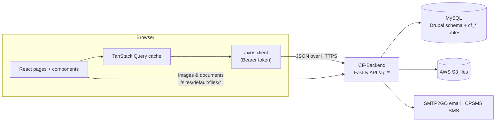

# CompanyFlow Frontend

Web app for **CompanyFlow**, MySigrid's platform for staff handbooks and everyday HR. It is a React and TypeScript single-page app (Vite) that talks to the **CF-Backend** REST API.

## Contents

- [Who uses it](#who-uses-it)
- [System architecture](#system-architecture)
- [Tech stack](#tech-stack)
- [Getting started](#getting-started)
- [Environment variables](#environment-variables)
- [Project structure](#project-structure)
- [How the app is put together](#how-the-app-is-put-together)
- [Feature modules](#feature-modules)
- [The handbook](#the-handbook)
- [Conventions](#conventions)
- [Scripts](#scripts)
- [Deployment](#deployment)
- [Gotchas](#gotchas)

## Who uses it

| Audience | What they do |
|----------|--------------|
| **Employees** | Read the staff handbook (and any extra handbooks meant for them) in their language, sign receipts, take quizzes, sign documents, report concerns through the whistleblower scheme |
| **Company admins** (account owner, company admins, senior employees) | Choose and write handbook pages and publish them, invite and follow up employees, manage departments, employment types, contacts, appearance, subscription and data retention |
| **CompanyFlow staff** | Use the admin console at `/admin`: customers, subscriptions, template texts, CRM, tickets, invoices, newsletters, taxonomy, key figures, and "view as company" |

## System architecture



- **The frontend holds no business data.** Everything comes from the backend, and the backend enforces permissions.
- **Guards are only for navigation.** The route guards here keep people away from screens they can't use; they don't protect data.
- **Files come from the backend too.** Uploaded files and pictures are served by the backend at `/sites/default/files/...`. [src/lib/utils.ts](src/lib/utils.ts) rewrites those paths to the API's origin: `resolveBackendUrl` for single URLs, `resolveHtmlUrls` for HTML from the text editor.

## Tech stack

| Area | Choice |
|------|--------|
| UI | React 18, TypeScript 5 |
| Build / dev server | Vite 5 (`@` → `src/`) |
| Routing | React Router 6, lazy-loaded routes |
| Server state | TanStack React Query 5 |
| HTTP | axios (one shared client) |
| Styling | Tailwind CSS 3 + `@tailwindcss/typography`, shadcn/ui-style primitives, Radix (select, tooltip) |
| Rich text | TipTap 3 (starter kit, link, underline), used in the handbook editors |
| Translations | i18next + react-i18next + browser language detector (Danish and English) |
| Other | sonner (toasts), lucide-react (icons), qrcode (QR codes for handbook pages) |

## Getting started

### Prerequisites

- Node.js 20 or newer, and npm.
- A running CF-Backend. By default it is at `http://localhost:3001`, and it allows the dev server's origin (`http://localhost:5173`) through CORS.

### Install and run

```bash
npm install
echo "VITE_API_BASE_URL=http://localhost:3001/api" > .env
npm run dev        # http://localhost:5173
```

### Build

```bash
npm run build      # tsc (type-check) + vite build -> dist/
npm run preview    # serve dist/ locally
```

## Environment variables

Vite reads these at build time, so changing one needs a rebuild.

| Variable | Purpose |
|----------|---------|
| `VITE_API_BASE_URL` | Backend API base, including `/api`, e.g. `http://localhost:3001/api`. Its origin is also used to load files. |
| `NEXT_PUBLIC_API_BASE_URL` | Old fallback name for the same value; prefer `VITE_API_BASE_URL` |

On GitHub Actions, the build sets Vite's `base` to `/<repository>/` so the app works under GitHub Pages ([vite.config.ts](vite.config.ts)).

## Project structure

```
src/
  main.tsx                 Entry point
  app.tsx                  Providers: React Query, Auth, Appearance, router, toasts
  router/index.tsx         All routes (lazy-loaded) and route guards
  context/
    auth-context.tsx       Session: token, /auth/me, login/logout, UI language
    appearance-context.tsx Company colours as CSS variables (console + handbook)
    view-as-employee-context.tsx  Lets admins preview the app as an employee
  features/<feature>/      One folder per feature (see Feature modules)
  components/
    ui/                    Basic UI primitives (button, input, dialog, …)
    common/                Shared pieces (empty state, page header, signature pad, error boundary …)
    layout/                Page shell, top navigation, impersonation banner
  layouts/                 App and auth layouts
  pages/console/           The landing dashboard
  lib/
    axios-client.ts        Shared axios instance + interceptors
    rbac.ts                Admin-console permission matrix (mirror of the backend's)
    utils.ts               cn(), backend URL helpers, link helpers
    text-diff.ts           Word diff for handbook page history
    …                      Error helpers, SMS sender rules, marketing links
  i18n/
    index.ts               i18next setup
    locales/{da,en}/*.json Translations per namespace
  types/models.ts          Shared domain types
```

Each feature folder follows the same pattern, though not every folder has every file:

```
features/<feature>/
  api.ts        Calls to the backend through axiosClient
  queries.ts    React Query key factories
  hooks.ts      useQuery / useMutation hooks
  routes.ts     Route path constants and helpers
  components/   Components used only by this feature
  pages/        Routed screens
```

## How the app is put together

### Providers

The providers wrap the app in this order: `QueryClientProvider`, then `AuthProvider`, then `AppearanceProvider`, then the router (inside `ViewAsEmployeeProvider` and `Suspense`). Toasts sit at the top level.

React Query defaults:
- data is not refetched when the window regains focus;
- a failed request is retried once, but never after a `429`.

### Authentication

- **Login.** `POST /auth/login` returns a JWT. The app keeps it in `localStorage` under `token`, and the axios request interceptor adds it as `Authorization: Bearer …`.
- **Page load.** `AuthProvider` loads the current user from `/auth/me` and switches the UI language to the user's preference when the company allows it, else Danish.
- **Other ways in.** Magic links (`/magic-link/:token`), email verification and password reset each have their own public route.
- **"View as company"** ([features/admin/impersonation.ts](src/features/admin/impersonation.ts)). Staff can enter a customer's console: the app stashes the staff token, swaps in a short-lived token, and shows a banner until they return.

### Route guards

The guards are in [src/router/index.tsx](src/router/index.tsx).

| Guard | Lets through |
|-------|--------------|
| `RequireAuth` | Any logged-in user |
| `RedirectIfAuth` | Only logged-out users (login, signup, reset pages) |
| `RequireSeniorRole` | `administrator`, `account_owner`, `company_admin`, `senior_employee` |
| `RequireAdminRole` / `RequireStrictAdmin` | `administrator`, `account_owner`, `company_admin` |
| `RequirePlatformAdmin` | CompanyFlow staff (any role that `lib/rbac.ts` allows into `/admin`) |
| `RequireAccountDashboard` | Superadmin and Admin only |

While an admin uses "view as employee", the admin guards send them back to `/`.

### Data fetching and errors

- **API calls.** Every call goes through [src/lib/axios-client.ts](src/lib/axios-client.ts). Its response interceptor:
  - copies the API's `error` object onto the thrown error;
  - replaces `403` messages with one translated sentence;
  - gives `429` (rate limited) a readable message.
- **Response shape.** Most endpoints answer `{ data, meta, error }`; some handbook endpoints return the object directly. Each feature's `api.ts` unwraps the response.
- **Reads** use `useQuery` with key factories from `queries.ts`. **Writes** use mutations, then invalidate or refetch.

### Appearance

[appearance-context.tsx](src/context/appearance-context.tsx) loads the company's colours (`/company/appearance`) and applies them as CSS variables across the console. The handbook uses its own fixed `--hb-*` variables. On the Appearance page, a company also picks the kind of standard pictures shown with CompanyFlow's texts: own pictures only, small pictures, or photographs.

### Translations

- **Languages.** Danish (`da`) is the default and the fallback; English (`en`) is complete.
- **Namespaces.** `common`, `auth`, `console`, `employees`, `handbook`, `account`, `contacts`, `admin`, `whistleblower`, with one JSON file per namespace in each language folder.
- **Detection order.** `localStorage`, then the browser. A logged-in user's preference wins.
- **Adding text.** Every new key goes into **both** `da` and `en`.

## Feature modules

| Feature | What it covers |
|---------|----------------|
| `auth` | Login, signup, magic link, email verification, forgot/reset password |
| `handbook` | Page list, editors, themes, publish, preview, print, employee viewer, extra handbooks, page history, QR codes, employee dashboard |
| `employees` | Employee list, add/edit, CSV import, statistics, page views, message logs, follow-up, employment type assignment |
| `employment-types`, `departments` | Company employment types and (nested) departments |
| `contacts` | Internal and external contacts, areas, visibility, import/export |
| `account` | Company profile, appearance, subscription and licences, languages, data retention, whistleblower settings |
| `documents` | Employee documents to sign or approve |
| `quizzes` | Quiz editor and results for handbook pages, quiz taking |
| `whistleblower` | Public report form, follow-up by access code, handler inbox |
| `management-handbook` | The management handbook reader |
| `user-manual` | Built-in help manual and "Brugermanual" buttons |
| `profile`, `companies` | Own profile; company views |
| `admin` | The `/admin` console for CompanyFlow staff: dashboard, companies, users, subscriptions, CRM, tickets, invoices, newsletters, taxonomy, handbook template editor, key figures, analytics, activity, settings |

## The handbook

The biggest feature lives in [src/features/handbook](src/features/handbook).

- **Page list** (`/handbook/pages`). Chapters appear as tabs; each page shows its status (Klar, Ikke klar, Fravalgt, Udgivet) and tags such as *Tilføjet tekst*, *Dokument* and *Billede*.
- **Page editor** (`/handbook/pages/:id/edit`). The page can use CompanyFlow's text, an edited copy of it, or the company's own text (TipTap). The editor also handles:
  - the page's picture and its placement;
  - documents, links and internal notes;
  - responsible people;
  - visibility by employment type or department;
  - receipts, and notifying employees.

  Saving sends the whole page back, so every list the editor loads must also be sent.
- **Pictures.** [page-picture.ts](src/features/handbook/page-picture.ts) chooses what readers see: the page's own picture, else CompanyFlow's standard picture for the text. `imagePlacement` positions it, and `none` hides it.
- **Extra handbooks.** A bar lets admins switch between the staff handbook and extra handbooks; the selected book travels in the URL as `?book=<bid>`.
- **Reading and output.** The employee viewer is at `/handbooks/:handbookId/viewer?page=<nid>`. Preview, sneak peek, print view and publish screens show the same content as employees see.

## Conventions

- **Code.**
  - TypeScript everywhere; functional components with hooks; named exports.
  - Kebab-case file and folder names; import from `src/` with `@/…`.
- **Where code goes.**
  - Each feature's code stays in its folder.
  - Shared building blocks go in `components/common`, `components/layout` or `components/ui`.
  - New routes are added lazily in `src/router/index.tsx`.
- **Keep in sync with the backend.**
  - **Permissions:** `src/lib/rbac.ts` mirrors `CF-Backend/src/common/rbac/permissions.ts`; change both.
  - **Response fields:** the backend drops any field its route schema doesn't list, so a new field must be added to that schema before the frontend can use it.
- **Commit messages.** Use `type: short summary` (`feat`, `fix`, `refactor`, `docs`, `chore`, `test`).

## Scripts

| Command | What it does |
|---------|--------------|
| `npm run dev` | Vite dev server on port 5173 |
| `npm run build` | Type-check (`tsc`), then a production build into `dist/` |
| `npm run preview` | Serve the production build locally |
| `npm run lint` | ESLint (the repository has no ESLint config yet, so this currently fails) |
| `npx tsc --noEmit` | Type-check only |

## Deployment

- **Production.** The app runs on Railway, next to the backend. This repository is the development source; production deploys from a mirror of it whenever its `main` branch is pushed.
- **GitHub Pages.** [.github/workflows/deploy-github-pages.yml](.github/workflows/deploy-github-pages.yml) builds the `develop` branch for a static preview there.
- **Build output.** The output is static files (`dist/`). The API address is baked in at build time through `VITE_API_BASE_URL`.

## Gotchas

- **Rate limit.** The backend allows 100 requests per minute per IP. The employee viewer, print and preview load every page up front, so large handbooks can hit the limit. When that happens, axios shows a "Too many requests" message.
- **Uploaded files.** Use `resolveBackendUrl` / `resolveHtmlUrls` for anything the backend serves; plain relative paths break in production.
- **Dev tunnels.** `vite.config.ts` allows an ngrok host for testing on other devices.

---

**Developer:** Miguel Gasang | Senior Fullstack Developer @ MySigrid ([mgasang@mysigrid.com](mailto:mgasang@mysigrid.com))  
**UI/UX:** Chelle ([rfuertes@mysigrid.com](mailto:rfuertes@mysigrid.com))
